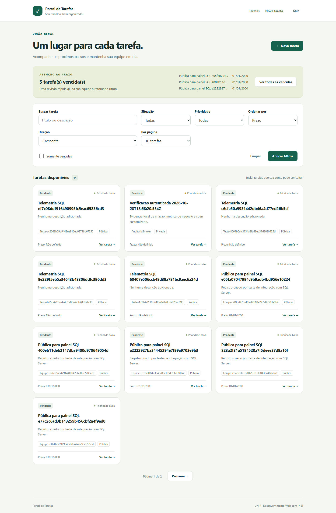
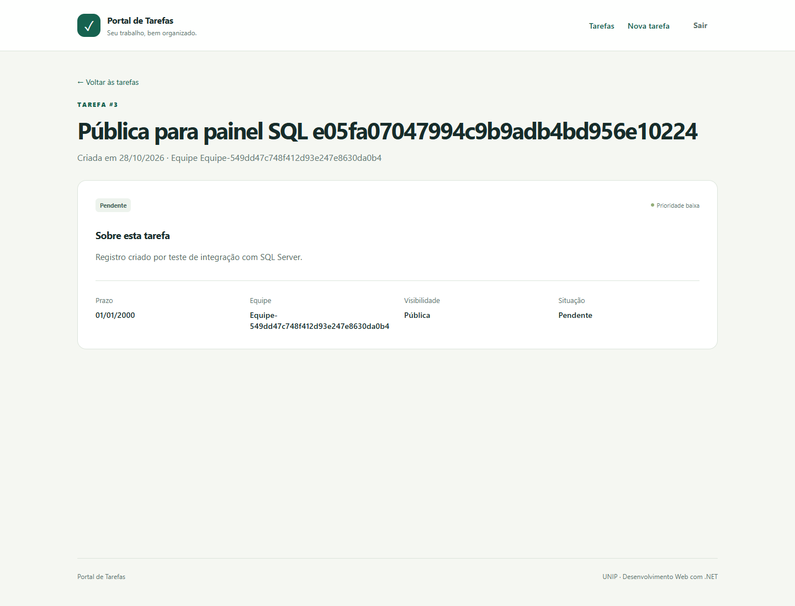
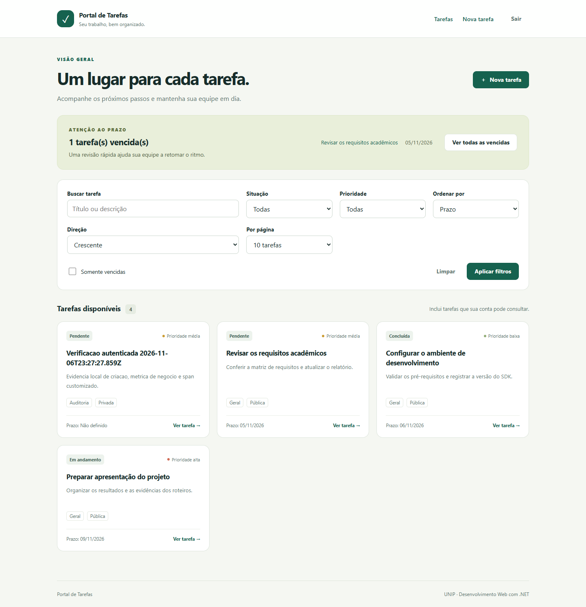
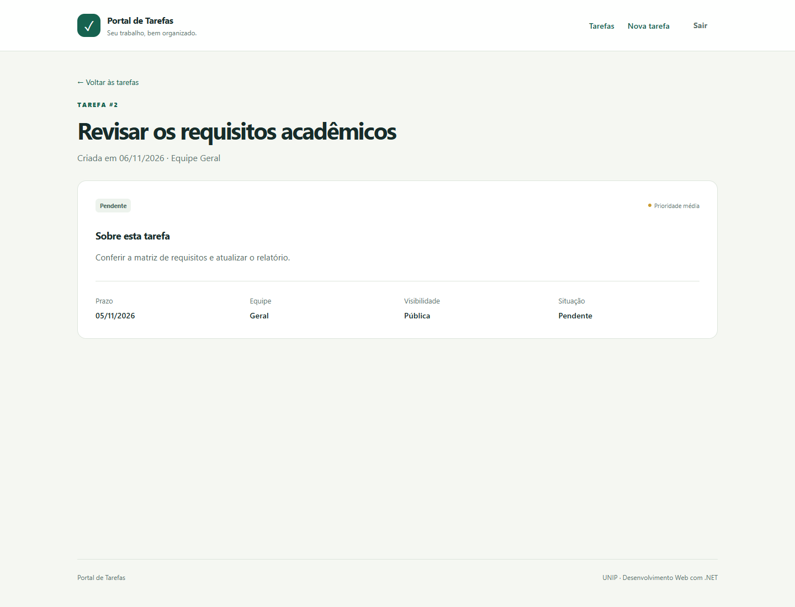
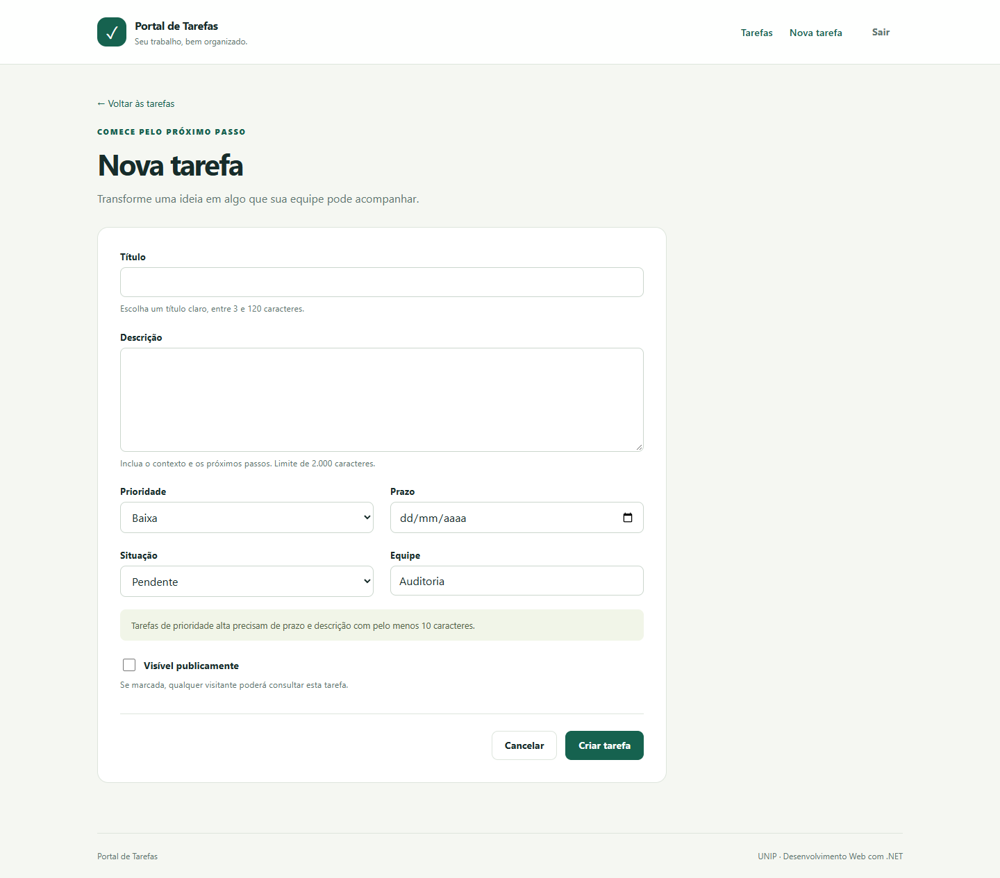
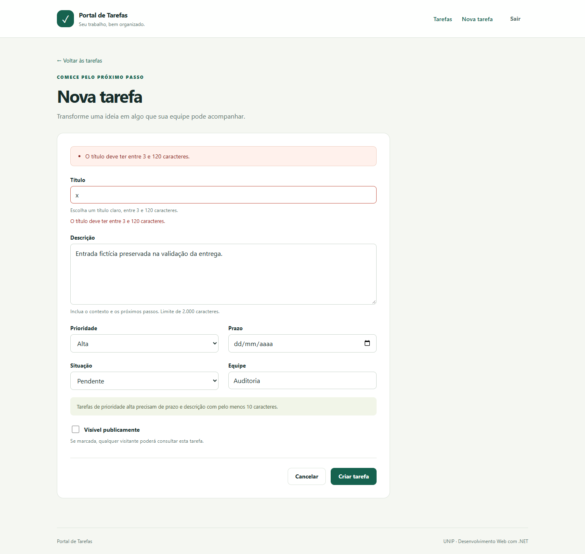

# Roteiro 2 — Controllers, validação, filtros e Razor

**Disciplina:** Desenvolvimento Web com .NET — UNIP. **Fonte:** Roteiros.pdf, páginas 6–8. **Consolidação:** 29/10/2026.

## Objetivo e ferramentas

Construir e validar interface MVC cumulativa com modelos tipados, validação, filtro de ação e componentes Razor reutilizáveis. São utilizados ASP.NET Core 10, Razor/Tag Helpers, Data Annotations e testes xUnit. O resultado de cada execução permanece separado da descrição da implementação.

O Portal mantém a API e acrescenta uma interface MVC para listar, consultar, cadastrar, editar e excluir tarefas. O projeto continua cumulativo: `ITarefaService` desacopla os controllers do armazenamento; `InMemoryTarefaService` permite a demonstração explícita em Development/Testing, e `EfTarefaService` preserva os mesmos contratos com SQL Server.

## Implementação verificável

| Requisito | Arquivos e comportamento |
| --- | --- |
| Controller MVC e rota convencional | `Controllers/TarefasController.cs`; `Program.cs` registra `AddControllersWithViews` e `{controller=Tarefas}/{action=Index}/{id?}`. |
| Serviço por interface | `Services/ITarefaService.cs`, `InMemoryTarefaService.cs` e `EfTarefaService.cs`. Nenhuma coleção de tarefas fica no controller. |
| Entrada e validação | `DTOs/TarefaDtos.cs`: `TarefaInputModel` usa Data Annotations e `IValidatableObject`. Prioridade alta exige prazo e descrição com pelo menos 10 caracteres. |
| ModelState | POSTs Create/Edit consultam `ModelState.IsValid` antes do serviço. Retornam a mesma view e o mesmo modelo em caso de erro; exceções de validação do serviço são acrescentadas ao resumo. |
| ViewModels | `ViewModels/TarefaFormModel.cs` acrescenta ID e versão ao modelo de entrada; `TarefasListaViewModel.cs` reúne consulta e resultado paginado. |
| Views fortes | `Views/Tarefas/Index.cshtml`, `Details.cshtml`, `Create.cshtml`, `Edit.cshtml`, `Delete.cshtml`. Cada view declara `@model`. |
| Layout e partials | `Views/Shared/_Layout.cshtml` compartilha navegação; `_TarefaResumo.cshtml` renderiza cartões; `Views/Tarefas/_Formulario.cshtml` evita divergência entre cadastro e edição. |
| Tag Helpers | Formulários usam `asp-action`/`asp-for`; links usam `asp-route-id`; `asp-validation-for` e `asp-validation-summary` exibem os erros retornados pelo servidor. |
| Filtro de ação | `Filters/LogAcaoFilter.cs`: registra nome da ação, duração em milissegundos e tipo de resultado. Não registra argumentos, corpos, senha ou token. |
| Interface | `wwwroot/css/site.css`: layout responsivo, estados vazios, foco visível, navegação por teclado e mensagens em português; sem dependência de CDN. |

## Comportamento dos formulários

O cadastro bem-sucedido redireciona para os detalhes da tarefa, impedindo reenvio do POST ao atualizar a página. O formulário inválido mantém título, descrição, prazo, prioridade, situação, equipe e visibilidade enviados. A validação é feita no servidor e funciona sem JavaScript.

O modelo de edição inclui `RowVersion`. Se outra sessão salvar primeiro, o POST devolve status 409 e preserva os valores digitados. O usuário pode copiar suas alterações e usar **Recarregar dados** para consultar a versão atual. O controller não troca silenciosamente a versão de concorrência.

Cadastro/edição exigem autenticação, exclusão exige Administrador e todos os POSTs usam antiforgery. A interface oculta ações incompatíveis com a conta; o serviço verifica as permissões novamente. Login/logout ficam em `ContaController`, com redirecionamento de retorno restrito a URLs locais.

## Filtro e reutilização

O filtro é global porque toda ação MVC deve ter o mesmo registro básico de execução. Essa escolha evita esquecer o atributo em novos controllers. O filtro observa a execução; ele não valida entrada nem substitui Data Annotations, ModelState, autorização ou regras do serviço.

Layout, partials e Tag Helpers compartilham apresentação e geração de URLs/nomes de campos. Regras de validação e autorização permanecem nos modelos, controllers e serviços; as views apenas apresentam os dados e ações disponíveis.

## Aprimoramento

`TarefasVencidasViewComponent`, em `ViewModels/TarefasVencidasViewComponent.cs`, usa `ITarefaService` para consultar as três tarefas vencidas mais antigas e o total filtrado. `Views/Shared/Components/TarefasVencidas/Default.cshtml` mostra as tarefas e um link para o filtro completo. O filtro de vencidas é aplicado no serviço antes da paginação e respeita a visibilidade do usuário. Tarefas concluídas e tarefas sem prazo não entram na lista. A data civil usa America/Sao_Paulo.

## Validação e evidências

Os resultados efetivamente executados são consolidados em `docs/STATUS_DE_EXECUCAO.md` e `docs/evidencias/`. Este relatório descreve o código entregue e não afirma que houve execução histórica de uma versão intermediária isolada do roteiro 2.

Para repetir a validação da versão cumulativa:

```powershell
dotnet build PortalTarefas.sln
dotnet test tests/PortalTarefas.Tests/PortalTarefas.Tests.csproj
dotnet run --project src/PortalTarefas.Web --launch-profile https
```

Com o banco configurado e usuários de teste criados pelo seed, verificar listagem, detalhes, cadastro, edição, formulário inválido, conflito entre duas abas e os logs estruturados do filtro. O modo Memory permite validar leitura pública sem banco; o login Identity continua dependendo de SQL Server. Os testes automatizados podem usar autenticação de teste, sem alterar o esquema de produção.

A execução prioritária consolidada dos roteiros 1 e 2 aprovou 4 testes, registrados em `docs/evidencias/roteiros-1-2.trx`. Essa execução verifica pipeline, quatro fontes de binding, códigos HTTP, Create/Edit/Details, preservação de entrada, filtro e View Component com autenticação exclusiva do ambiente de teste. A integração SQL/Identity foi exercitada separadamente; seus resultados ficam no status central. TestServer não comprova uma conexão TLS real do navegador.

Na revisão de 29/10, a suíte cumulativa também verifica o View Component de vencidas com visibilidade/ordem e o formulário MVC contra SQL Server. Uma captura real anterior encontrou validação implícita indevida do campo de versão no cadastro. A correção tornou esse campo anulável em Create e manteve a exigência explícita em Edit; a regressão envia o campo oculto vazio como o navegador. A captura inicial com esse erro não representa o resultado final corrigido.

As [capturas finais de 29/10](../evidencias/roteiro-02-mvc/manifest.json) foram coletadas de MVC/SQL Server reais, sem interceptação HTTP nem alteração de DOM. Lista e detalhes responderam 200. O formulário inválido preservou `x` e a descrição, mostrou somente o erro de título em português e manteve o total de tarefas em 15 antes/depois. Login e logout reais responderam 200/204. A exceção de certificado local foi limitada ao contexto de captura. O [histórico do erro anterior](../evidencias/roteiro-02-mvc/historico-rowversion-20261028/README.md) permanece identificado como diagnóstico.






## Validação final de 06/11/2026

Após a aprovação de 55 testes .NET e 33 React, foram capturadas novamente lista, detalhes, cadastro e validação em MVC/SQL Server reais, usando HTTPS e conta sintética. O binário respondeu com a versão `5bf8fefcdd2b7b02dfb7012f8663e584a530b79e`; as alterações posteriores desta entrega abrangem CI, scripts e documentação, sem mudança do código da aplicação. O [manifesto definitivo](../evidencias/capturas-finais/2026-11-06T23-29-32-812Z/manifest.json) identifica ambiente, banco exclusivo, navegador, status HTTP e hashes. Os cadastros inválidos mantiveram quatro tarefas antes/depois; login/logout responderam 200/204. Nenhuma resposta, estado ou DOM foi fabricado; a exceção TLS ficou limitada ao navegador local de captura. Os registros de 29/10 acima permanecem históricos.









## Conclusão

As responsabilidades da interface, validação e serviço permanecem separadas e cumulativas. A aprovação dos cenários automatizados é evidência concreta; transcrições de telas e demais requisitos ainda dependem dos artefatos identificados na matriz. Não se presume a conclusão de um requisito pela presença de sua view.
