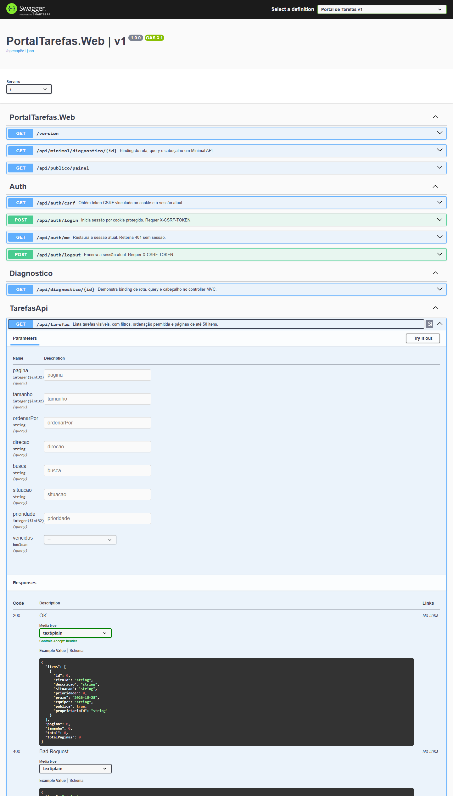

# Roteiro 4 — API REST, OpenAPI e cliente TypeScript

**Disciplina:** Desenvolvimento Web com .NET — UNIP. **Fonte:** Roteiros.pdf, páginas 12–14. **Consolidação:** 29/10/2026.

## Objetivo, introdução e ferramentas

Expor tarefas como recursos HTTP com contrato revisável, erros padronizados e cliente TypeScript regenerável. A solução usa controllers ASP.NET Core 10, EF Core 10, OpenAPI nativo, Swagger UI em Development e `openapi-typescript`/`openapi-fetch` no cliente.

## Desenvolvimento e contrato

`DTOs/TarefaDtos.cs` distingue criação, atualização, resumo e detalhes. Atualização exige `rowVersion`; entidades EF não são retornadas diretamente. A tabela abaixo descreve o contrato principal. Erros adicionais de configuração/infraestrutura seguem o tratamento centralizado.

| Método e rota | Sucesso | Falhas pertinentes |
|---|---|---|
| `GET /api/tarefas` | 200, página de tarefas visíveis | 400 consulta inválida; 429 limite |
| `GET /api/tarefas/{id}` | 200, detalhes e versão | 404 inexistente/não visível; 429 |
| `POST /api/tarefas` | 201, detalhes e `Location` | 400 validação/CSRF; 401; 403; 429 |
| `PUT /api/tarefas/{id}` | 200, detalhes com nova versão | 400; 401; 403; 404; 409; 429 |
| `DELETE /api/tarefas/{id}?rowVersion=...` | 204 | 400; 401; 403; 404; 409; 429 |

A consulta aceita `pagina` (padrão 1), `tamanho` (padrão 10, máximo 50), `ordenarPor` (padrão `prazo`) e `direcao` (`asc`/`desc`). Campos de ordenação permitidos: prazo, titulo, prioridade, situacao, criadaem e id. Há desempate por identificador. Filtros: busca, situacao, prioridade e vencidas. O serviço aplica visibilidade, filtros, contagem, ordenação e paginação antes de materializar a leitura.

`PaginaDto` inclui itens, página, tamanho, total e total de páginas. Página vazia permanece resposta 200 com coleção vazia. Erros de validação usam Problem Details com erros por campo; a extensão de correlação não revela credenciais ou dados internos. A versão obsoleta resulta em 409 sem sobrescrever a alteração concorrente.

## OpenAPI e geração

`AddOpenApi` e `MapOpenApi` expõem `/openapi/v1.json` no ambiente Development. O documento real é exportado para `docs/openapi.json`; `scripts/Generate-Client.ps1` baixa esse documento e executa `npm run generate:client`. `schema.d.ts` é artefato gerado, e `client.ts` usa os caminhos/DTOs para verificar as chamadas. Não se escreve um segundo contrato manual para corrigir erros do gerador.

```powershell
powershell.exe -NoProfile -ExecutionPolicy Bypass -File scripts/Generate-Client.ps1 -ApiUrl https://localhost:7240
Push-Location src/PortalTarefas.Frontend
npm.cmd run typecheck
npm.cmd run smoke:client -- --api-url https://localhost:7240
Pop-Location
```

O bypass afeta somente o processo PowerShell que executa o script local. Com `pwsh` e política compatível, o script pode ser chamado diretamente. A URL deve apontar para uma API real em Development; documento e tipos devem ser regenerados depois de alterações no contrato. O relatório de execução deve guardar o comando, endereço sem segredos e resultado da chamada real.

## Decisões e aprimoramento

A API usa controllers pela validação, organização por recurso e integração com os filtros existentes. Metadados de paginação são o aprimoramento escolhido. A lista permitida de ordenação evita tratar entrada do usuário como SQL dinâmico. A escolha de 409 e do token Base64 é explícita e consistente com MVC/SPA.

## Testes, evidências e conclusão

`ApiTests` exercita CRUD, Location, entrada inválida, página vazia, recurso inexistente e conflito. Os resultados efetivos e o log da geração/chamada ficam em [STATUS_DE_EXECUCAO.md](../STATUS_DE_EXECUCAO.md) e `docs/evidencias/frontend-*`. A evidência da UI interativa é a [captura real da Swagger UI](../evidencias/roteiro-04-openapi.png), carregada de Development com 15 operações e o GET de tarefas expandido. O [metadado da captura](../evidencias/roteiro-04-openapi.json) registra Chrome/Playwright, URL, status 200 e a exceção local de certificado do contexto de captura. Nenhuma requisição mutante foi executada para produzir essa imagem.



A implementação e a geração são verificadas separadamente. A atividade só pode ser declarada concluída quando o contrato tiver sido gerado/revisado, os casos HTTP obrigatórios tiverem sido executados e a chamada real do cliente estiver comprovada.

O cliente gerado executou leituras reais sobre SQL Server via HTTPS, com 200 para página e detalhe. Um segundo fluxo obteve CSRF, autenticou, renovou CSRF, criou tarefa com 201, leu detalhes com 200 e encerrou sessão com 204. Os logs são `frontend-cliente-sql.txt` e `frontend-cliente-autenticado.txt`; os valores de cookies/tokens/credenciais não foram copiados para a evidência. O Node validou o certificado com a CA pública local configurada para o processo.

O [registro HTTP final](../evidencias/http-contrato.json) preserva os corpos reais dos quatro casos exigidos: lista 200, página vazia 200, validação 400 e recurso inexistente 404. O contrato final inclui exemplos de cadastro/criação/validação e o esquema do cabeçalho CSRF. Em Production, [OpenAPI e Swagger responderam 404](../evidencias/production-documentacao-restrita.json), confirmando a restrição ao ambiente apropriado.
