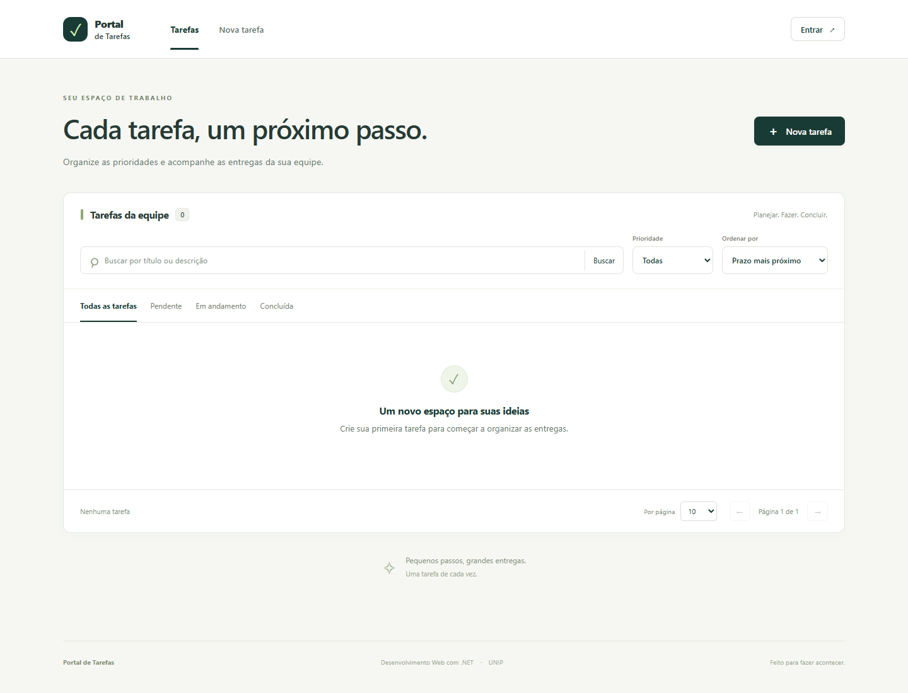
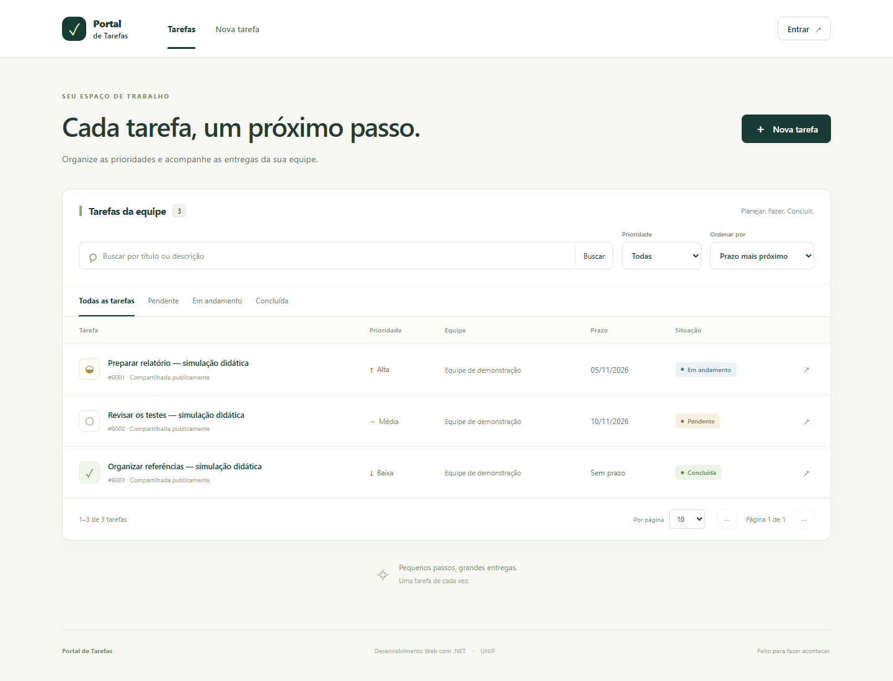
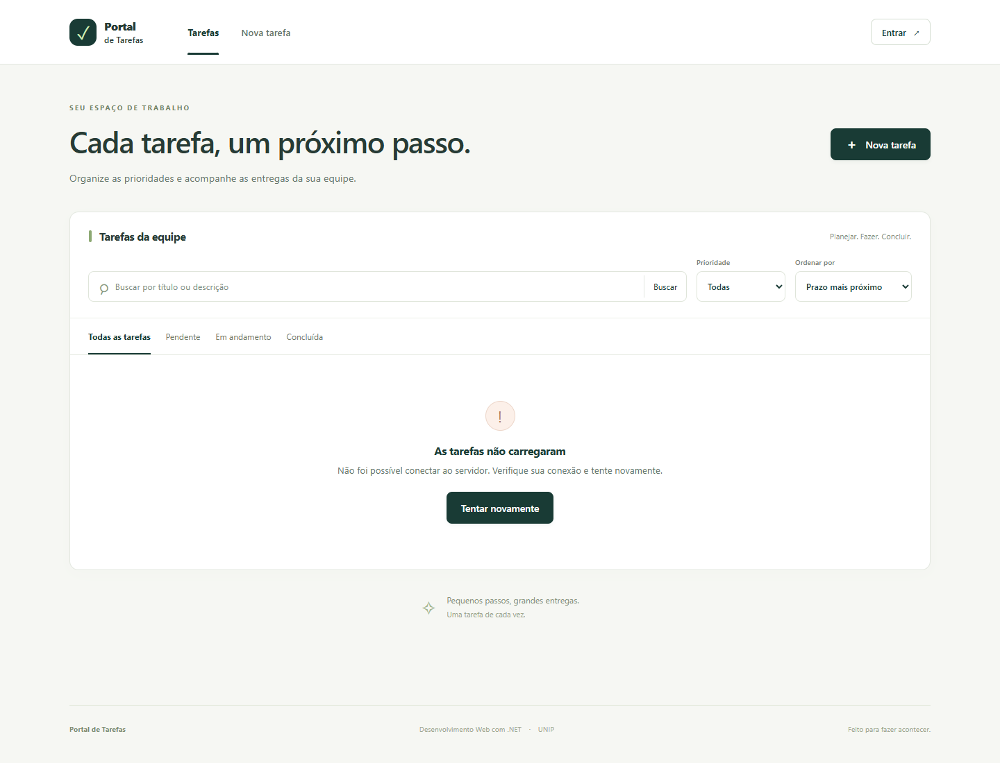
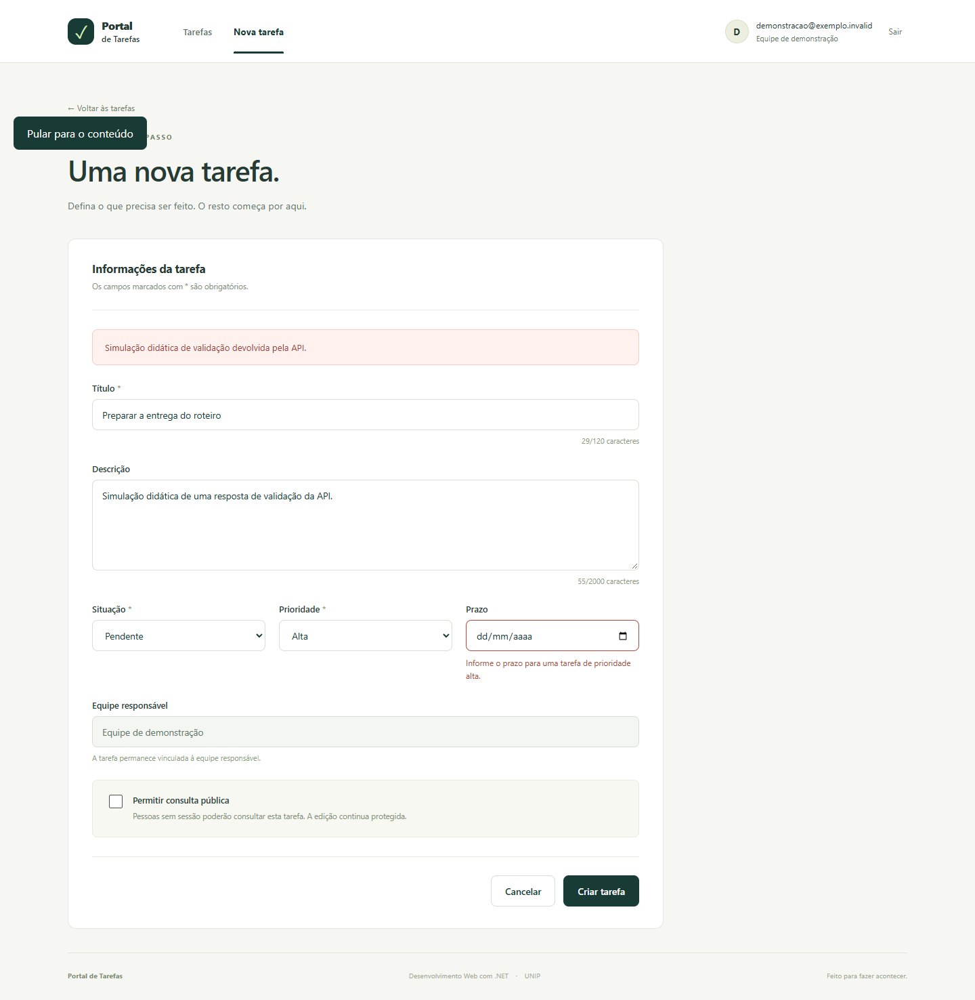
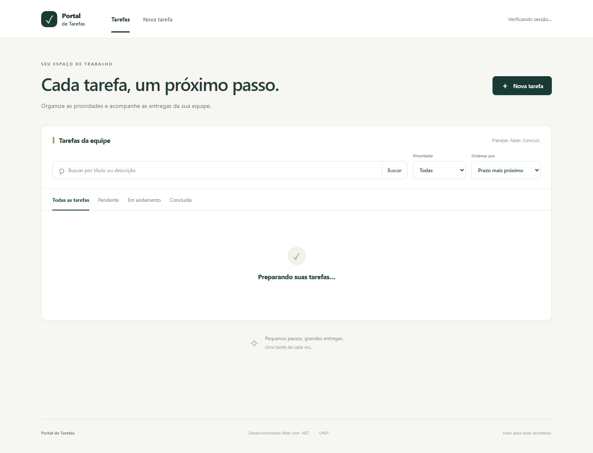
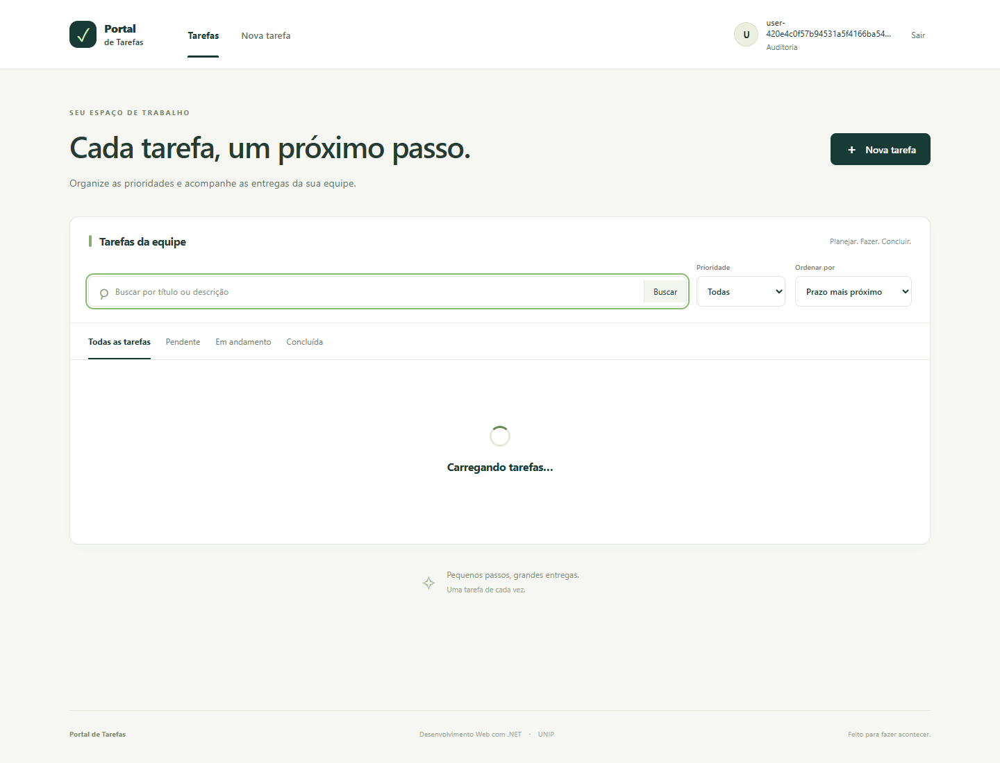
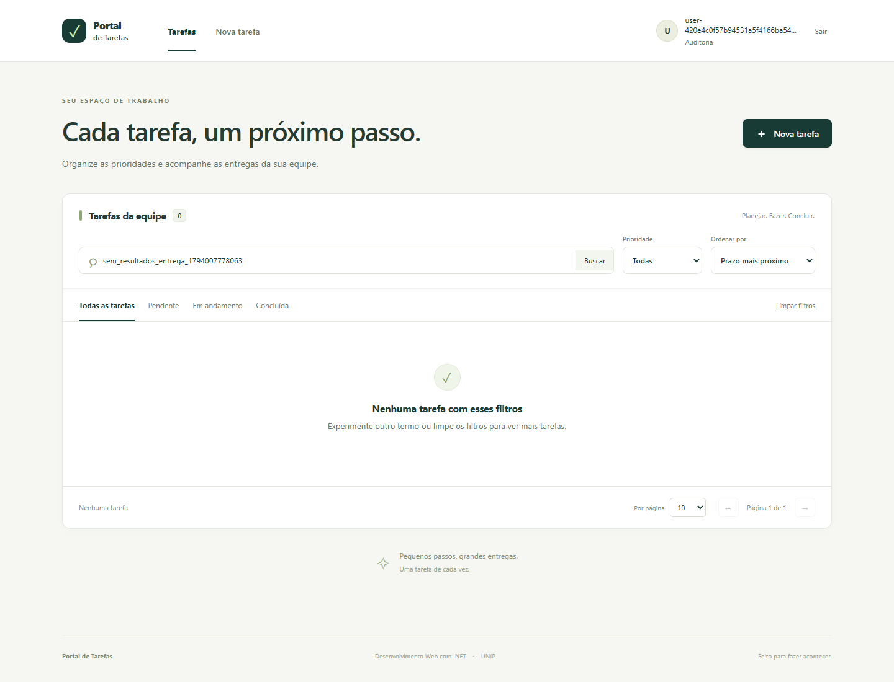
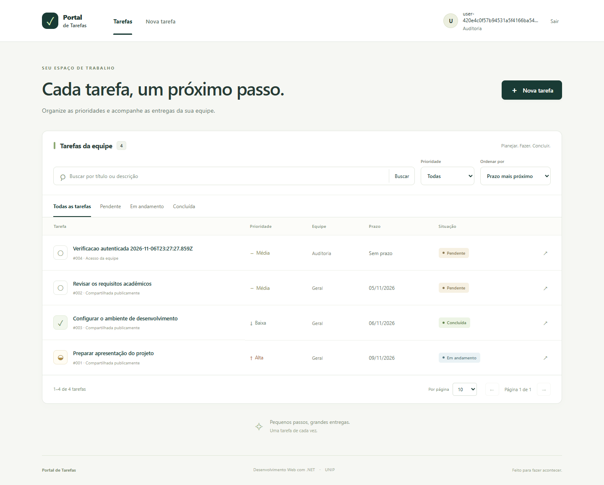
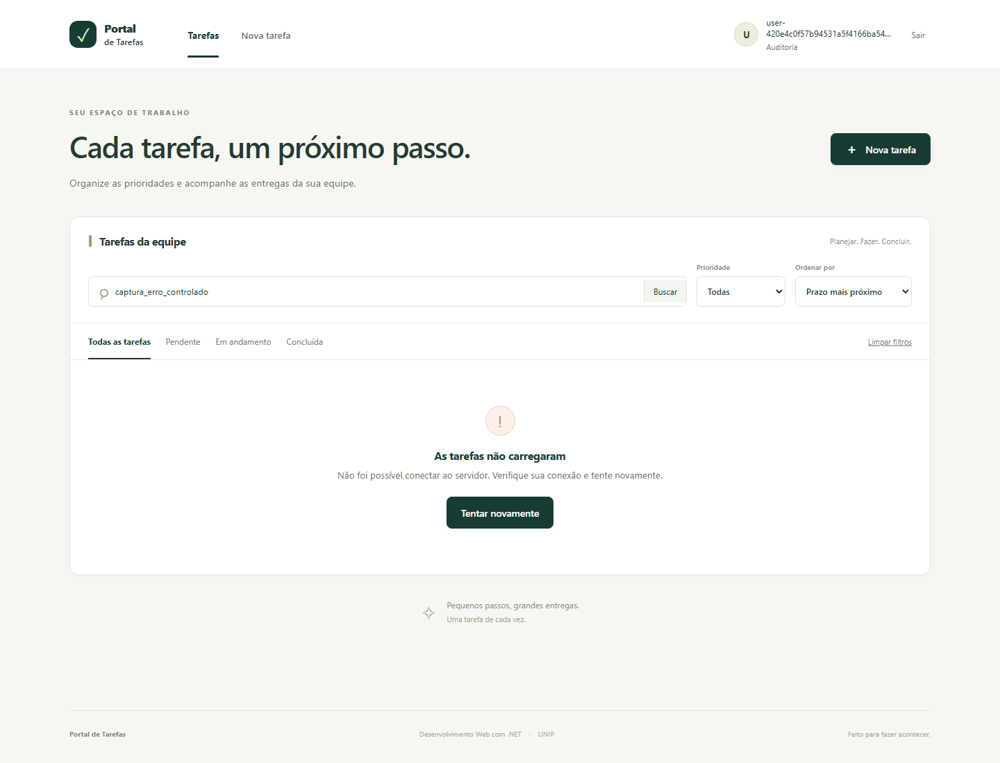
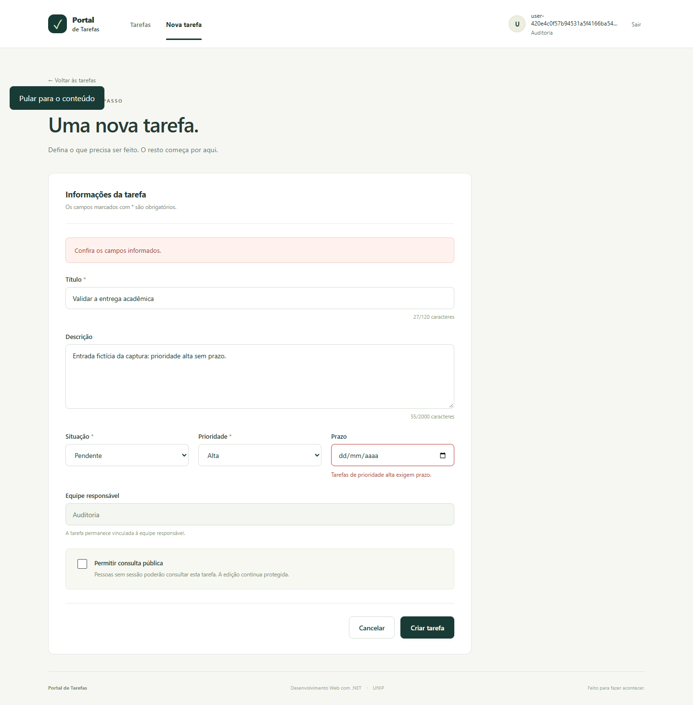

# Roteiro 5 — React, TypeScript e integração

**Disciplina:** Desenvolvimento Web com .NET — UNIP. **Fonte:** Roteiros.pdf, páginas 15–17. **Consolidação:** 29/10/2026.

## Objetivo, introdução e ferramentas

Criar uma SPA que consome o contrato tipado, representa estados de requisição e permite navegar por lista, detalhes e formulário. O frontend utiliza Vite, React, TypeScript, React Router, Vitest e Testing Library. Versões e comandos efetivamente usados são registrados nas evidências, sem confundir build aprovado com uso completo no navegador.

## Desenvolvimento e funcionalidades

`App.tsx` declara rotas de lista, detalhes, cadastro, edição e login. O acesso HTTP passa por `api/client.ts` e `api/http.ts`; os schemas vêm do OpenAPI real. `VITE_API_URL` configura a URL pública. O proxy Vite encaminha `/api` à API HTTPS local e evita chamadas HTTP dispersas nos componentes.

| Estado | Apresentação esperada | Verificação |
|---|---|---|
| idle | Estado inicial anterior à conclusão da primeira consulta | Teste de componente e captura real |
| loading | Feedback de carregamento e anúncio acessível | Resposta atrasada e captura |
| empty | Mensagem e ação adequada sem tarefas | Resposta com coleção vazia |
| success | Dados e metadados de paginação | Resposta válida com itens |
| error | Mensagem compreensível e recuperação | Falha de rede/HTTP/Problem Details |

Filtros, ordenação e paginação são serializados na URL. A consulta direta por URL deve reproduzir a lista; detalhes usam identificador e apresentam 404. O formulário mostra erros de campo devolvidos pela API. Requisições obsoletas são canceladas/ignoradas para não substituir dados atuais depois de navegação.

## Decisões de integração e acessibilidade

Em desenvolvimento, o proxy é adequado ao navegador local; a API mantém política CORS explícita para acesso direto quando necessário. A publicação integrada em `/app/` facilita mesma origem e cookies seguros. O domínio não contém segredos em variáveis `VITE_*`, pois essas variáveis entram no bundle público.

Testes de componentes e da camada HTTP são a extensão selecionada e verificada. Também foram implementados foco visível, link para pular ao conteúdo, foco no título após navegação e anúncios de carregamento/erro. A interface reflete permissões do servidor; controles ocultos não substituem autorização.

## Testes, resultados e evidências

Testes existentes: `http.test.ts`, `query.test.ts`, `TaskList.test.tsx`, `TaskForm.test.tsx` e `auth.test.tsx`. Os comandos de restauração, testes, typecheck e build, seus resultados e limites estão em [STATUS_DE_EXECUCAO.md](../STATUS_DE_EXECUCAO.md). Evidências efetivamente coletadas ficam em `docs/evidencias/frontend-*.txt`.

A execução registrada aprovou 33 testes em cinco arquivos, o typecheck e o build de produção (54 módulos transformados). Os atributos e anúncios implementados são descritos pelo comportamento coberto; não se acrescenta uma certificação de acessibilidade ao escopo do roteiro.

```powershell
Push-Location src/PortalTarefas.Frontend
npm.cmd ci
npm.cmd run typecheck
npm.cmd test
npm.cmd run build
Pop-Location
```

As seis capturas abaixo foram feitas em Chrome 156, com a SPA publicada em `https://localhost:7240/app/`. A página e o React são reais; dados, sessão, atrasos e falhas foram controlados por interceptação HTTP para reproduzir os estados. Elas comprovam a apresentação dos cenários simulados e não substituem os testes SQL/Identity. O estado idle foi capturado pausando o quadro transitório via CDP, antes do efeito de consulta, sem editar DOM ou estado React. O [manifesto da captura](../evidencias/roteiro-05-ui/2026-10-28T18-54-28-931Z/manifest.json) registra os limites.

| Cenário | Evidência real |
|---|---|
| idle | [01-idle.png](../evidencias/roteiro-05-ui/2026-10-28T18-54-28-931Z/01-idle.png) |
| loading | [02-loading.png](../evidencias/roteiro-05-ui/2026-10-28T18-54-28-931Z/02-loading.png) |
| empty | [03-empty.png](../evidencias/roteiro-05-ui/2026-10-28T18-54-28-931Z/03-empty.png) |
| success | [04-success.png](../evidencias/roteiro-05-ui/2026-10-28T18-54-28-931Z/04-success.png) |
| error de rede | [05-error-network.png](../evidencias/roteiro-05-ui/2026-10-28T18-54-28-931Z/05-error-network.png) |
| Problem Details no formulário | [06-problem-details.png](../evidencias/roteiro-05-ui/2026-10-28T18-54-28-931Z/06-problem-details.png) |










## Validação final de 06/11/2026

A [nova execução frontend](../evidencias/finalizacao-20261106/frontend/resumo.json) aprovou npm ci, 33 testes em cinco arquivos, zero falhos/ignorados, typecheck e build de produção com 54 módulos. A auditoria npm consultada após liberação da rede sandbox informou zero vulnerabilidades. A regeneração do cliente preservou integralmente o arquivo de tipos.

As seis imagens finais abaixo usam a aplicação real em `https://localhost:8340/app/`, SQL Server exclusivo e sessão sintética real. A [versão e os hashes](../evidencias/capturas-finais/2026-11-06T23-29-32-812Z/manifest.json) identificam o binário `5bf8fefcdd2b7b02dfb7012f8663e584a530b79e`; as mudanças posteriores são de CI, scripts e documentação. Success consulta dados fictícios reais; empty usa um filtro inexistente; Problem Details resulta de POST real com prioridade alta sem prazo, HTTP 400 e erro associado ao campo. Loading retém temporariamente a requisição real; error aborta uma consulta no navegador e confirma a recuperação ao tentar novamente. Idle pausa o quadro transitório via CDP antes do efeito React. Nenhum corpo HTTP, DOM ou estado React foi fabricado. A exceção TLS aplica-se somente ao navegador de captura. As imagens de outubro permanecem como histórico dos cenários então simulados.













## Conclusão

O frontend possui páginas, estados e camada HTTP identificáveis. O estado de conclusão acompanha a matriz: build e testes podem estar aprovados enquanto capturas ou navegação manual continuam pendentes. Essa separação preserva a evidência verdadeira da entrega.
